<div align="center">

# TaskTrack

**An Academic Task Management System for Students**

*“Track Your Tasks. Take Control of Your Time.”*

Group 6 • CPE 408 / CPE 31S1


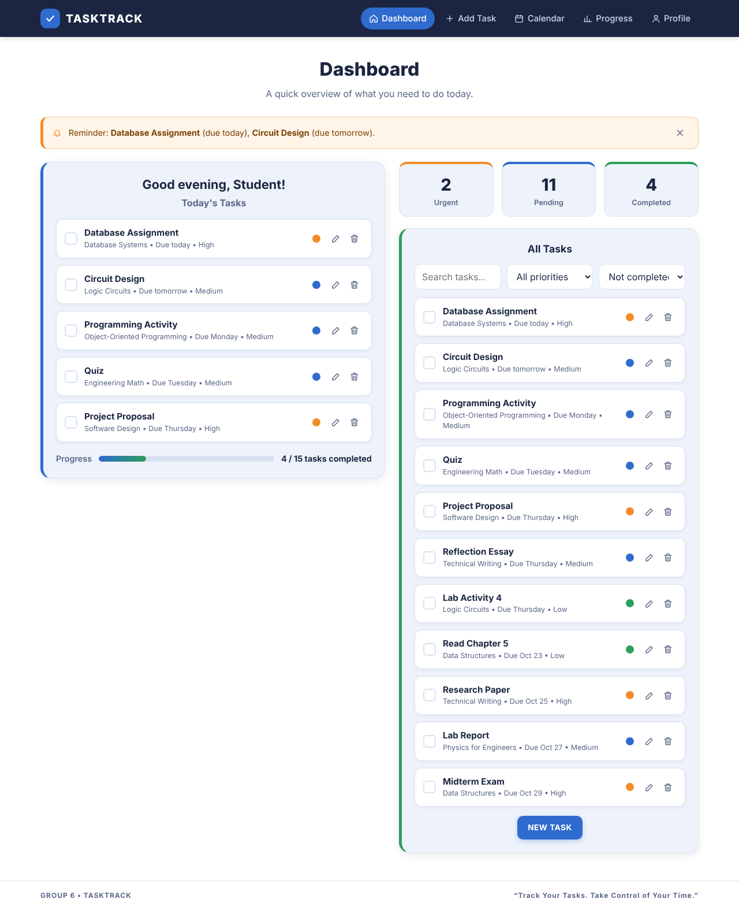

</div>

---

## Table of Contents

1. [Concept](#concept)
2. [Purpose](#purpose)
3. [Target Users](#target-users)
4. [Features](#features)
5. [Screenshots](#screenshots)
6. [How It Works](#how-it-works)
7. [Design Consistency](#design-consistency-with-our-uiux-proposal)
8. [Project Structure](#project-structure)
9. [How to Run](#how-to-run)
10. [Technologies Used](#technologies-used)
11. [Group Members](#group-members)

---

## Concept

**TaskTrack** is a web-based task manager built for college and university students. It turns scattered school requirements (assignments, projects, quizzes, exams, and reports from different subjects) into **one organized task list**.

The app follows four simple steps:

| Step | Action | What the student does |
|:---:|---|---|
| 1 | **Add** | Create a task with subject, deadline, and priority. |
| 2 | **Organize** | Tasks are grouped and sorted by urgency automatically. |
| 3 | **Remind** | Get reminders before deadlines. |
| 4 | **Complete** | Mark finished tasks and monitor progress. |

## Purpose

Students often struggle to manage many academic responsibilities at once:

- **Missed deadlines.** Assignments and projects from different subjects can have overlapping due dates.
- **Disorganized tasks.** Important tasks get scattered across notebooks, messages, and different apps.
- **Academic stress.** Poor organization leads to cramming, late submissions, and unnecessary stress.

**Goal:** give students one simple place to organize, prioritize, and track their academic tasks, so they miss fewer deadlines and work more productively.

## Target Users

| Primary users | What they need |
|---|---|
| College and university students | A clear view of upcoming deadlines |
| Students taking multiple subjects | Easy task creation and editing |
| Students managing assignments and projects | Priority indicators |
| Students who want better time management | Reminders and simple progress tracking |

## Features

| Feature | Description |
|---|---|
| **Task Creation** | Add assignments, projects, quizzes, exams, and other tasks with name, subject, type, due date, priority, and description. The form checks required fields before saving. |
| **Edit & Delete** | Update any task or remove it (with a confirmation dialog). |
| **Deadline Tracker / Calendar** | Monthly calendar showing every deadline as a color-coded chip. Busy days (3 or more tasks) are highlighted. Click a day to see its tasks or add a new one on that date. |
| **Reminders** | An in-app reminder banner lists overdue tasks and tasks due within your chosen reminder window. Optional browser notifications are available too. |
| **Priority Levels** | Label tasks **High** (orange), **Medium** (blue), or **Low** (green). |
| **Progress Tracking** | A board with **To Do / In Progress / Completed** columns. Move cards with drag-and-drop or arrow buttons. Shows your weekly completion percentage. |
| **Dashboard** | Greeting, today's focus tasks, pending / completed / urgent counters, overall progress bar, plus search and filters for all tasks. |
| **Profile & Settings** | Edit name, program, and year level. Set the default reminder time, switch between light and dark theme, and turn notifications on or off. |
| **Saved Data** | Tasks and settings are saved in the browser (`localStorage`), so they are still there after a page refresh. |
| **Responsive Design** | Works on desktop, tablet, and mobile, with a collapsible menu on small screens. |

## Screenshots

### 1. Dashboard
A quick overview of what the student needs to do today: greeting, today's tasks, counters, progress bar, and a reminder banner.


### 2. Add Task
A simple form keeps task creation fast. Required fields are checked before saving.

| Create New Task | Validation |
|---|---|
| 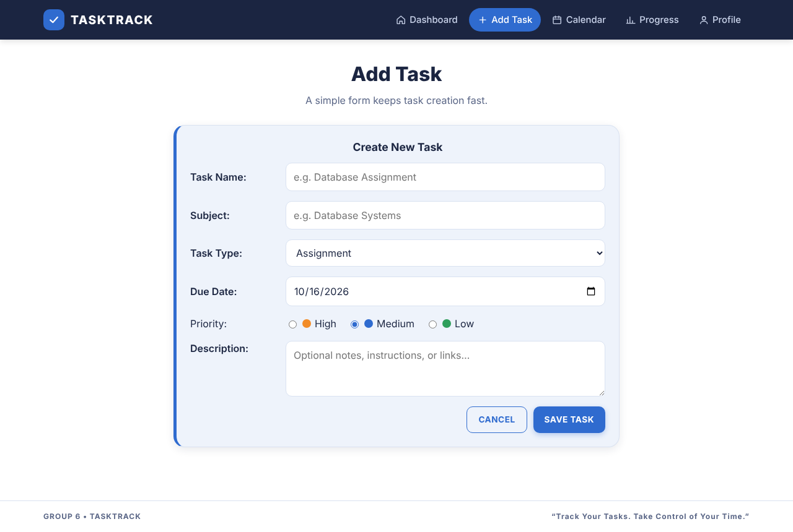 | 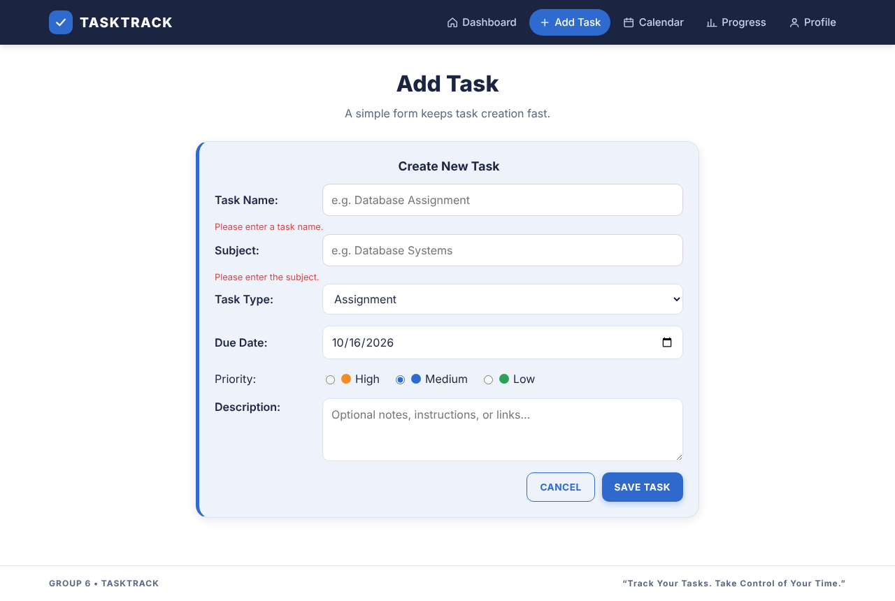 |

### 3. Calendar
See deadlines by day and spot busy periods. Colors match task priority.

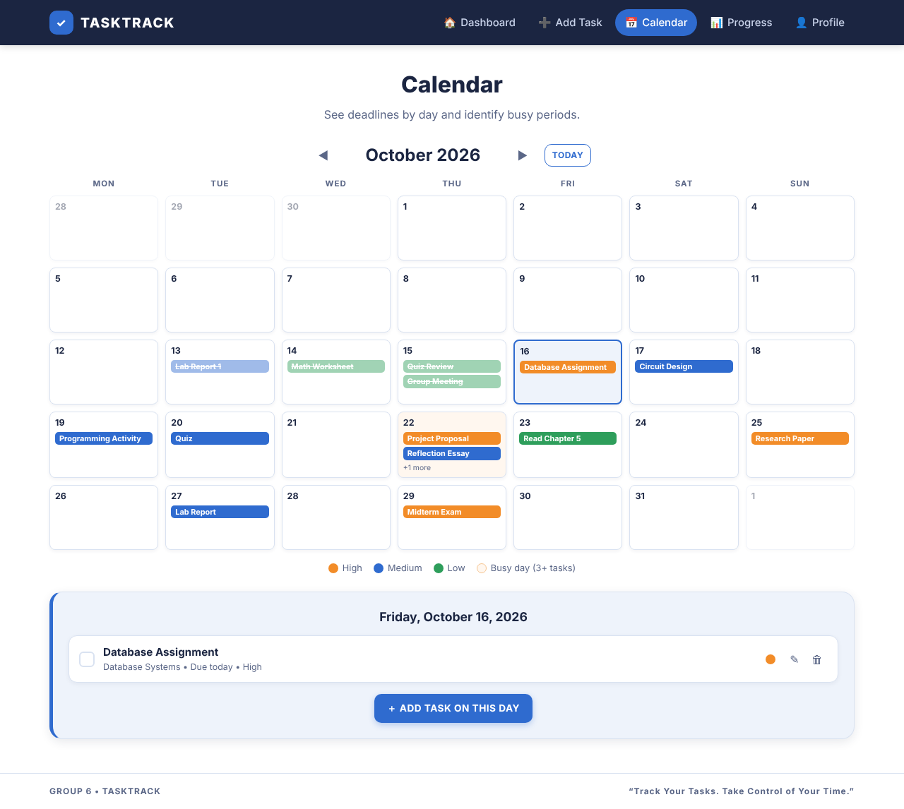

### 4. Progress Tracking
A clear status view shows what remains. Drag cards between columns.

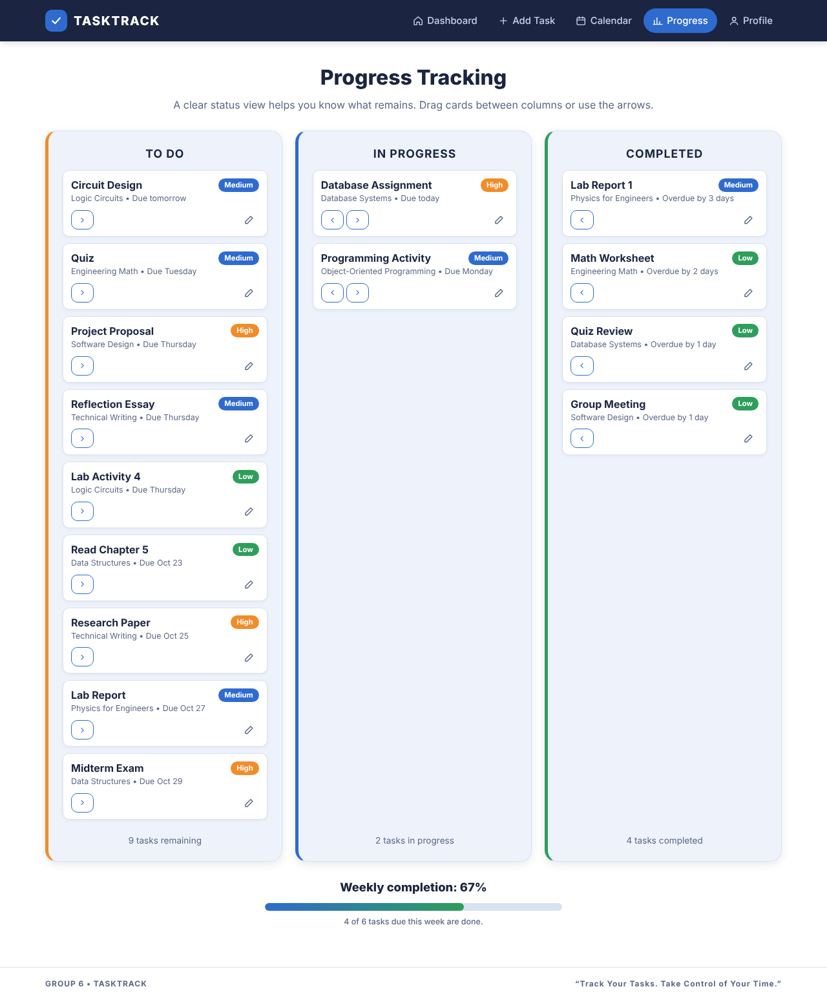

### 5. Profile & Settings
Student details, academic preferences, reminder time, and theme settings.

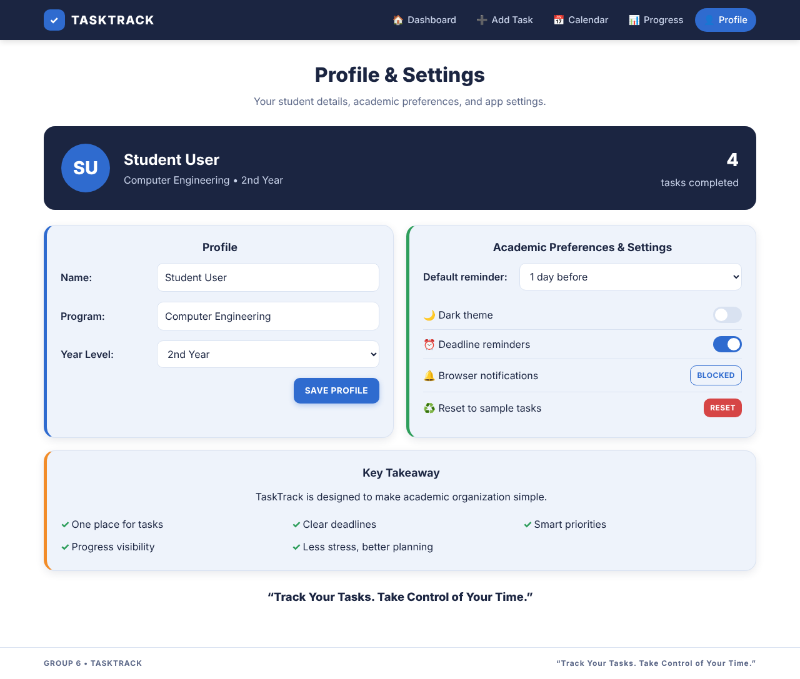

### 6. Dark Theme
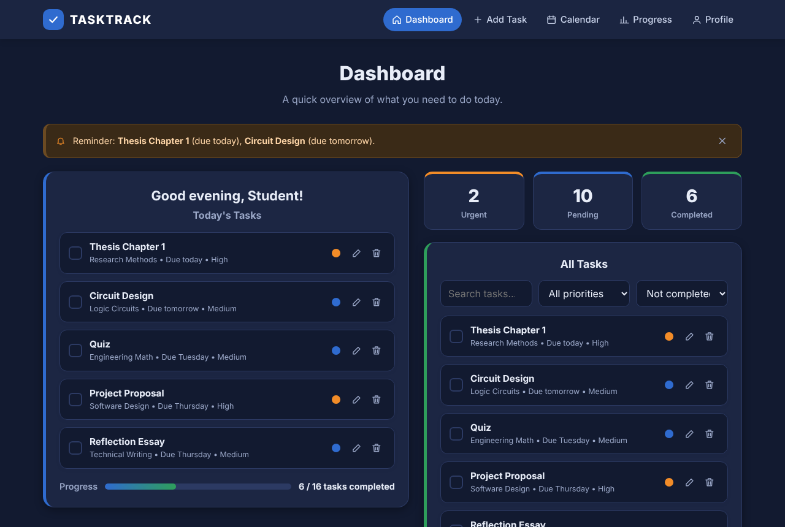

### 7. Mobile View
| Dashboard | Navigation menu | Calendar |
|---|---|---|
| 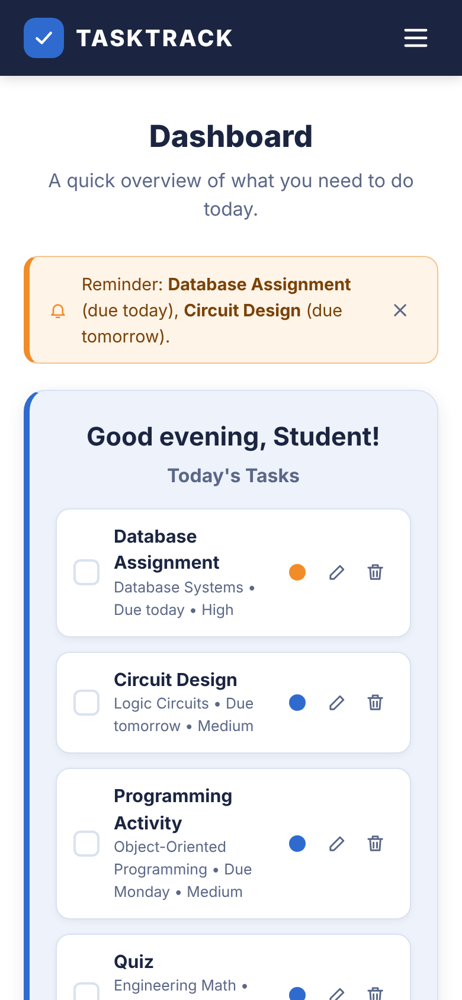 | 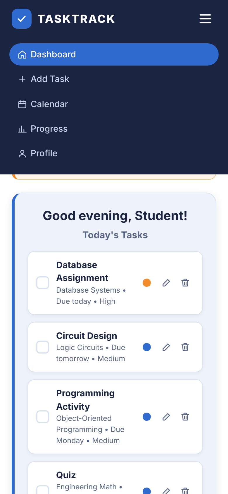 | 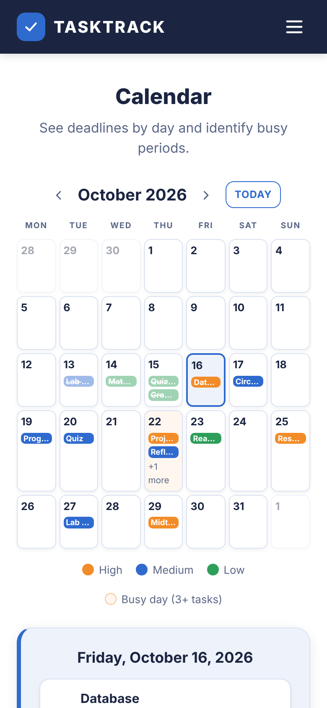 |

## How It Works

```
 ┌──────────┐    ┌──────────────┐    ┌──────────────┐    ┌──────────────┐
 │   ADD    │ ─▶ │   ORGANIZE   │ ─▶ │    REMIND    │ ─▶ │   COMPLETE   │
 │ Add Task │    │ Dashboard &  │    │ Reminder     │    │ Progress     │
 │  page    │    │ Calendar sort│    │ banner/alerts│    │ board & stats│
 └──────────┘    │ by urgency   │    └──────────────┘    └──────────────┘
                 └──────────────┘
```

1. **Add:** the student fills in the *Add Task* form. The task is saved to `localStorage`.
2. **Organize:** tasks are sorted by due date, then by priority. Unfinished tasks always appear first.
3. **Remind:** each time the Dashboard opens, TaskTrack checks for tasks that are overdue or due within the reminder window (set on the Profile page) and shows a banner.
4. **Complete:** tick the checkbox, or move the card to *Completed* on the Progress board. Progress bars and counters update right away.

> **Note:** On first launch TaskTrack loads sample tasks (the same ones shown in our UI/UX design) so the app can be explored right away. Use **Profile → Reset to sample tasks** to restore them at any time.

## Design Consistency with Our UI/UX Proposal

The front end follows the layout, navigation, and look of our approved UI/UX design:

| UI/UX design slide | Implemented page |
|---|---|
| Design Example 1: Dashboard | `index.html` |
| Design Example 2: Add Task | `add-task.html` |
| Design Example 3: Calendar | `calendar.html` |
| Design Example 4: Progress Tracking | `progress.html` |
| Design Example 5: Profile & Settings | `profile.html` |

**Kept from the design:**

- Navy (`#1b2541`) brand color, used for the navigation bar and profile header
- Soft blue rounded cards with a colored **left accent bar**
- Priority colors: **orange = High**, **blue = Medium**, **green = Low**
- Centered page titles with a short subtitle, and the “GROUP 6 • TASKTRACK” footer
- Monday-first calendar grid, three-column To Do / In Progress / Completed board, and “Weekly completion” summary

<details>
<summary><strong>View the original UI/UX design slides</strong></summary>

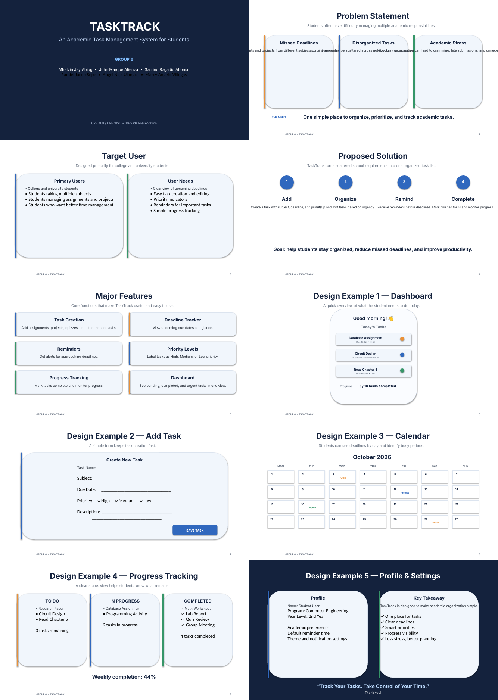

</details>

## Project Structure

```
TaskTrack/
├── index.html            # Dashboard
├── add-task.html         # Add / Edit task form
├── calendar.html         # Monthly deadline calendar
├── progress.html         # To Do / In Progress / Completed board
├── profile.html          # Profile & settings
├── css/
│   └── style.css         # All styles (design tokens, layout, dark theme, responsive)
├── js/
│   ├── app.js            # Shared: storage, navbar, reminders, helpers
│   ├── dashboard.js
│   ├── add-task.js
│   ├── calendar.js
│   ├── progress.js
│   └── profile.js
├── assets/
│   ├── screenshots/      # Images used in this README
│   └── design/           # Original UI/UX design reference
└── README.md
```

## How to Run

No installation or build step is needed.

**Option 1: Open directly**
1. Download or clone this repository.
2. Open `index.html` in any modern browser (Chrome, Edge, Firefox).

**Option 2: Local server (recommended)**
```bash
git clone https://github.com/alfonsosantino/TaskTrack.git
cd TaskTrack
python -m http.server 8000
# then open http://localhost:8000
```
Or use the **Live Server** extension in VS Code.

**Option 3: GitHub Pages**
Go to *Settings → Pages*, choose the `main` branch and the `/ (root)` folder, then save. The site will be live at `https://alfonsosantino.github.io/TaskTrack/`.

## Technologies Used

- **HTML5:** semantic page structure and forms
- **CSS3:** custom properties (design tokens), Flexbox, Grid, media queries, dark theme
- **JavaScript (ES6+):** DOM manipulation, `localStorage`, drag-and-drop API, Notification API
- **Google Fonts:** Inter

No frameworks or external libraries are used.

## Group Members

**Group 6**

- Mhelvin Jay Abiog
- John Marque Atienza
- Alfonso Santino Ragadio
- Ramiel Jacob Sepe
- Angel Nick Ulangca
- Marcy Angelo Villegas

---

<div align="center">

**TaskTrack** is designed to make academic organization simple.
One place for tasks • Clear deadlines • Smart priorities • Progress visibility • Less stress, better planning

</div>
